# RDTG — Requirements-Driven Test Generation

**Turn "the software shall…" requirements into test procedures and executable tests, automatically.**

Systems engineers write requirements such as *"When IGNITION_SW is ON and FUEL_PUMP_OK is true,
the software shall set ENGINE_RUNNING to true within 500 ms."* RDTG reads them and connects them
to the test rig's interfaces: discrete I/O, MIL-STD-1553, IEEE 1394, Ethernet and so on. It works
out how the requirements depend on each other, then generates:

- **Test documentation**: step-by-step procedures with expected results and a requirements
  traceability matrix.
- **Executable tests**: pytest files that drive the rig and run against simulated, partially
  simulated, or real hardware.

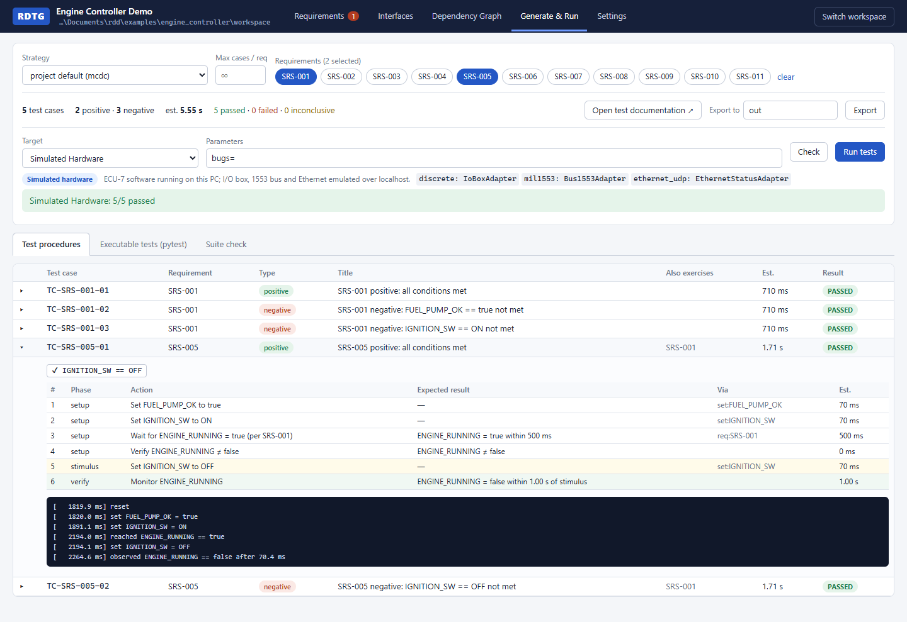

---

## Why

Test teams usually turn each requirement into a test by hand. That means:

- working out how to put the system into the right state, which often depends on *other*
  requirements (to test "the engine stops when the ignition goes off", the engine has to be
  running first);
- deciding which positive and negative cases to cover, and noticing the ones that can't occur;
- writing the procedure document *and* the script, and keeping both in step with the requirements
  and the interface control documents (ICDs).

RDTG automates that chain. It also checks the requirements as they are written and tells the
engineer when one can never be tested.

## What it does

### Write requirements in plain, structured English

Requirements use [EARS](https://alistairmavin.com/ears/) (Easy Approach to Requirements Syntax), the
"When / While / If … the software shall …" style common in aerospace and automotive. Each one is
parsed as you type into trigger, conditions, response and timing. Signal names come from the
interface catalog.

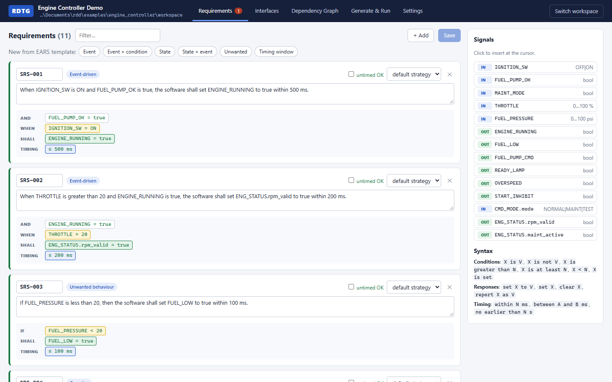

### Catch requirements that can't be tested

Requirements are checked against the catalog *and against each other*. RDTG flags unknown signals,
invalid values, missing timing, conflicting conditions, conditions nothing can produce, and
requirements that can **never be triggered** because of what other requirements say:

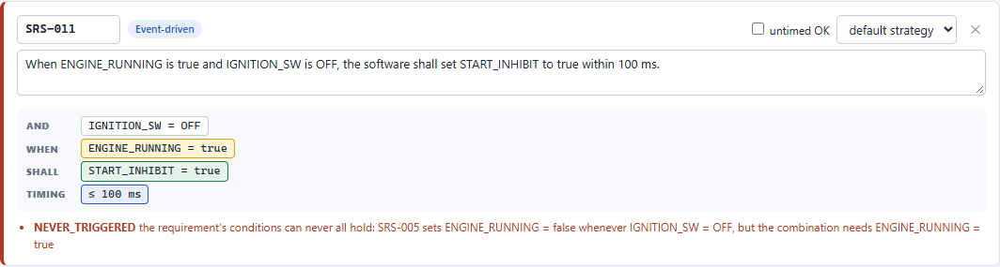

### Build a time-weighted dependency graph

When one requirement's output is another requirement's precondition, the two are linked
automatically. Every way of reaching a state is an edge weighted by how long it takes: driving a
rig input, sending an ICD message, running a scripted action, or relying on another requirement.
Each test sets itself up by the **cheapest path**. In the example, getting the engine running
goes through SRS-001 (640 ms) rather than the 4 s full start-up action.

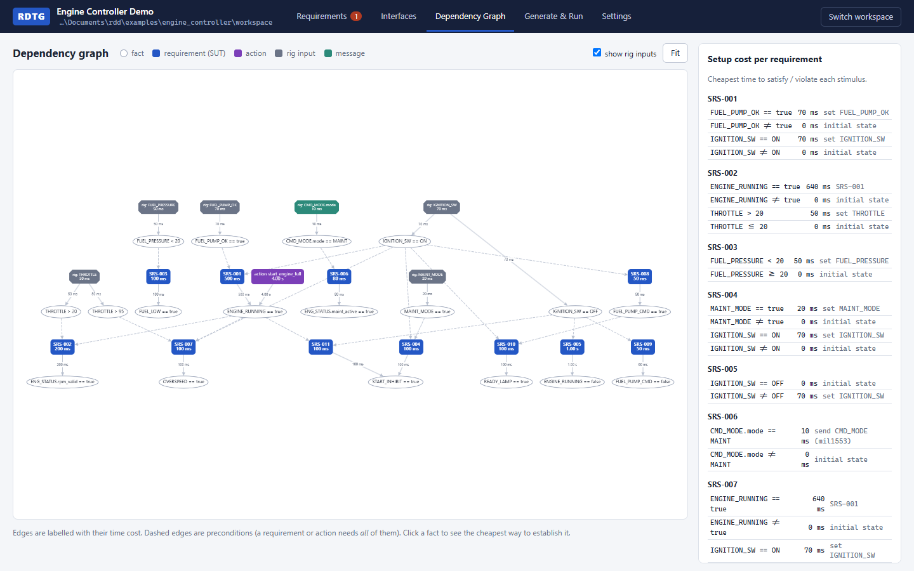

### Generate positive and negative cases, and skip the impossible ones

You choose how thoroughly each requirement is tested: every combination, MC/DC, pairwise, N
random cases, or positive only. Values at a boundary are tested at the boundary (`THROTTLE > 20`
is set up at 20 and triggered at 21).

Previous requirements often make some combinations impossible. In the example, the fuel-pump
command follows the ignition switch (SRS-008/009), so SRS-010 can never see *ignition ON with the
pump off*. RDTG works this out from the requirements themselves and reports the combination as
**not testable**, with the reason, instead of generating a test that could never pass:

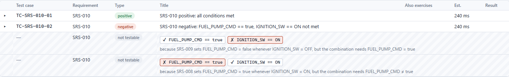

### Produce the test documentation and the test code

Both come from the same source, so they always match.

| Test procedure (HTML / Markdown) | Executable test (pytest) |
|---|---|
| 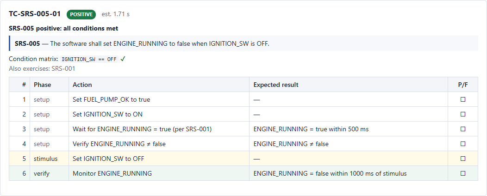 | 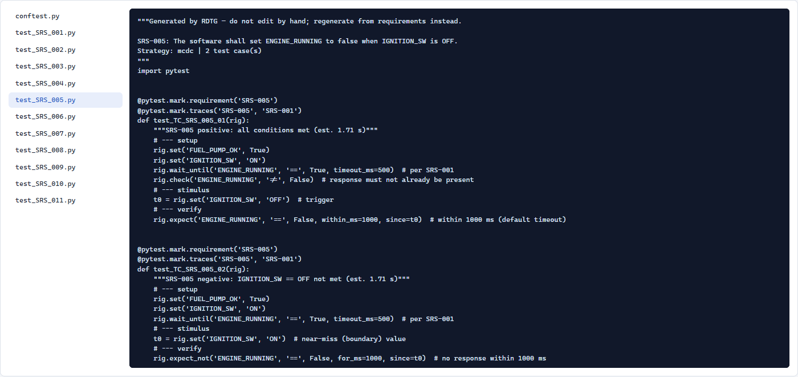 |

The document also contains a traceability matrix showing which tests verify each requirement and
which requirements other tests use as setup paths:

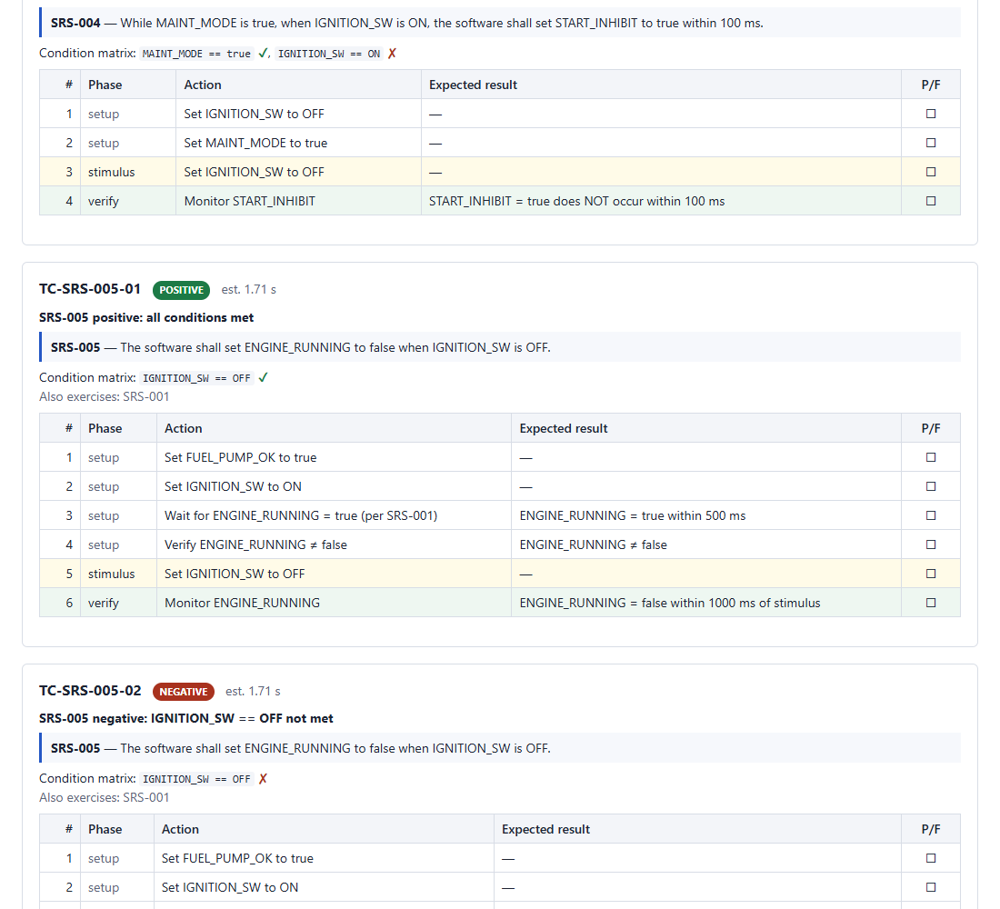

### Run against configurable targets

A **target** picks an adapter for each interface: discrete I/O, 1553, Ethernet… Mixing emulated
and real adapters gives *simulated*, *partially simulated* or *hardware* configurations, and the
generated tests are the same for all of them. A target that can't be opened (missing driver,
device unreachable) makes its tests *inconclusive* with the reason; they are never reported as
passed.

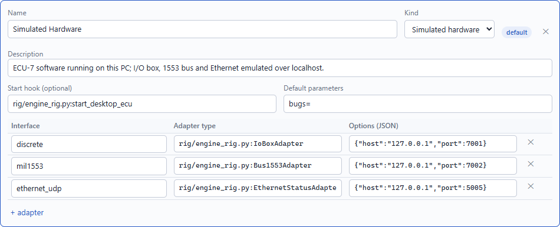

### Check the tests themselves

The **suite check** injects faults one at a time into an executable model of the requirements:
never responding, responding late or early, a stuck output, or ignoring a condition. It then
reports which faults the generated suite would catch. A missed fault shows a blind spot in the
tests. The suite check measures the *tests*; it says nothing about whether the software passes.

### Organise work in workspaces

Each project is a plain folder of YAML files, so it's easy to keep in version control. The web UI
opens on a workspace picker with recent workspaces, open-folder and create-new. The recent list is
stored in `~/.rdtg/recent.json` (set `RDTG_HOME` to move it).

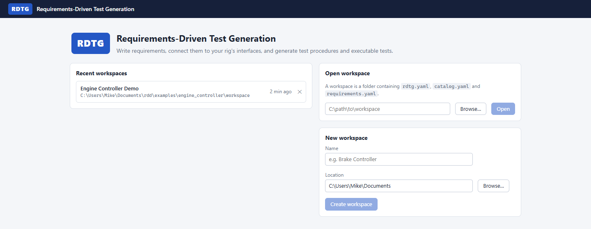

---

## How it works

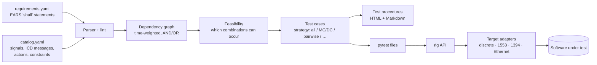

1. **Parse.** Each requirement becomes a trigger, conditions, a response and timing. Names and
   values are checked against the catalog.
2. **Graph.** Facts such as `ENGINE_RUNNING = true` are nodes. Rig inputs, messages, actions and
   other requirements are edges that produce them, weighted by time. A cost solver finds the
   cheapest way to reach any state.
3. **Feasibility.** Each requirement is also a rule ("whenever its conditions hold, its response
   holds"). Chaining the rules shows which combinations of conditions can't occur, and which
   expected results would contradict other requirements.
4. **Generate.** For each requirement and chosen combination, RDTG plans the setup (with the
   response *off* first, so a test can't pass by accident), the stimulus, and the verification
   with timing.
5. **Emit and run.** Jinja2 templates render the documents and the pytest files. The tests call
   a small `rig` API that dispatches to the selected target's adapters.

## Quick start

Requires **Python 3.10+** and **Node.js 18+** (for building the web UI).

```sh
git clone <this repository>
cd <repository>

python -m venv .venv
.venv/Scripts/pip install -e "backend[server]"      # Windows; on Linux/macOS use .venv/bin/pip
cd frontend && npm install && npm run build && cd ..

.venv/Scripts/rdtg serve                            # http://127.0.0.1:8000
```

Open **examples/engine_controller/workspace** from the workspace page, go to **Generate & Run**,
and click **Run tests**. RDTG starts the example engine-controller program and runs the generated
suite against it.

## The example: an engine controller

[`examples/engine_controller/`](examples/engine_controller/) is one example in two halves, kept
apart the way they would be on a real program:

```
examples/engine_controller/
  software/     the software under test: a standalone engine controller ("ECU-7") and its ICD.
                It does not use RDTG; it talks over a TCP discrete I/O box (port 7001),
                emulated 1553 over UDP (7002) and a 50 Hz Ethernet status message (UDP 5005).
  workspace/    the RDTG workspace that tests it: requirements, interface catalog, targets,
                and rig adapters written from the ICD.
```

The workspace has 11 requirements, including some that depend on each other and one (SRS-011)
that is impossible on purpose, so the checks have something to find. With the default MC/DC
strategy it generates 25 tests, which all pass against the example software.

The software has switchable bugs, so you can see the tests catch real faults:

```sh
EX=examples/engine_controller/workspace
.venv/Scripts/rdtg run $EX                                   # all pass
.venv/Scripts/rdtg run $EX --param bugs=fuel_low_boundary    # uses <= instead of <: a boundary test fails
.venv/Scripts/rdtg run $EX --param bugs=slow_spinup          # a timing test fails
.venv/Scripts/rdtg run $EX --target Hardware                 # inconclusive: no bench drivers installed
```

Available bugs: `fuel_low_boundary`, `no_fuel_pump_check`, `slow_spinup`, `slow_mode`,
`maint_ignored`. No test catches `maint_ignored`, and that's deliberate: no requirement says the
engine must not start in maintenance mode, so it's a gap in the requirements.

## Writing requirements

| Pattern | Template |
|---|---|
| Event-driven | When `<trigger>` [and `<condition>`…], the software shall `<response>` [within N ms]. |
| State-driven | While `<state>`, the software shall `<response>`. |
| State + event | While `<state>`, when `<trigger>`, the software shall `<response>`. |
| Unwanted behaviour | If `<condition>`, then the software shall `<response>`. |
| Optional feature | Where `<feature>`, the software shall `<response>`. |
| Ubiquitous | The software shall `<response>`. |

The trailing form (*"The software shall … when …"*) is accepted too.

- **Conditions:** `X is V`, `X is not V`, `X is greater than N`, `X is at least N`, `X < N`, `X is set`
- **Responses:** `set X to V`, `set X`, `clear X`, `report X as V`
- **Timing:** `within N ms`, `between A and B ms`, `no earlier than N s`

Conditions are combined with **and**. "or" isn't supported yet; write each alternative as its own
requirement.

## Interface catalog

`catalog.yaml` describes how the rig reaches the software. Costs feed the dependency graph's edge
weights.

```yaml
connection_points:
  - {name: IGNITION_SW, kind: enum, values: ["OFF", "ON"], direction: input, set_cost_ms: 20, settle_ms: 50}
  - {name: ENGINE_RUNNING, kind: discrete, direction: output}
messages:                                   # from the ICDs, normalised across transports
  - name: CMD_MODE
    transport: mil1553
    address: {rt: 5, sa: 3}
    fields: [{name: mode, kind: enum, values: [NORMAL, MAINT, TEST]}]
actions:                                    # scripted procedures, used as graph edges
  - {name: start_engine_full, produces: {ENGINE_RUNNING: true}, cost_ms: 4000, steps: [...]}
constraints:                                # physics no requirement states
  - {id: PHYS-1, never: "FUEL_PUMP_OK is false and FUEL_PRESSURE is greater than 60"}
```

Message fields are referenced as `MESSAGE.field` in requirements, e.g. `CMD_MODE.mode is MAINT`.
Quote enum values such as `"ON"` and `"OFF"` in YAML; unquoted, they are read as booleans.

## Test strategies

| Strategy | Cases for *n* conditions | Use when |
|---|---|---|
| `all` | up to 2ⁿ | small requirements, maximum confidence |
| `mcdc` (default) | up to n + 1 | each condition shown to matter on its own (DO-178C style) |
| `pairwise` | every pair of condition values | many conditions |
| `random:N` | N sampled combinations | quick spot checks |
| `positive_only` | 1 | smoke tests |

Set a default in `rdtg.yaml`, override it per requirement, and optionally cap the cases per
requirement. Impossible combinations are always skipped and listed with the reason.

## Test targets

Targets live in the workspace's `rdtg.yaml`, or can be edited under **Settings → Test targets** in
the UI:

```yaml
default_target: Simulated Hardware
targets:
  - name: Simulated Hardware
    kind: simulated                                  # simulated | partial | hardware
    start: rig/engine_rig.py:start_desktop_ecu        # optional hook, e.g. launch the software
    params: {bugs: ""}                                # overridable per run
    adapters:
      discrete:     {type: rig/engine_rig.py:IoBoxAdapter, host: 127.0.0.1, port: 7001}
      mil1553:      {type: rig/engine_rig.py:Bus1553Adapter, port: 7002}
      ethernet_udp: {type: rig/engine_rig.py:EthernetStatusAdapter, port: 5005}
  - name: Hardware
    kind: hardware
    adapters:
      discrete:     {type: rig/bench_drivers.py:DiscreteIOCard, device: PXI1Slot2}
      mil1553:      {type: rig/bench_drivers.py:Ddc1553Card, card: 0}
      ethernet_udp: {type: rig/engine_rig.py:EthernetStatusAdapter, host: 0.0.0.0, port: 5005}
```

To connect real equipment, subclass `rdtg.harness.TransportAdapter` and implement `write` /
`read` for discrete I/O, `send_message` / `read_message` for buses, and `reset`. Then reference
the class from a target; extra fields are passed to its constructor.
[`bench_drivers.py`](examples/engine_controller/workspace/rig/bench_drivers.py) is a template for
NI-DAQmx and DDC 1553 cards.

Only one run can use a target at a time. The web UI releases the target after each run.

## Command line

```sh
rdtg serve [WORKSPACE]                      # web UI (workspace picker if none given)
rdtg lint WORKSPACE                         # parse and check requirements
rdtg graph WORKSPACE [--dot graph.dot]      # cheapest setup path for every condition
rdtg generate WORKSPACE [--strategy S] [--max-cases N] [--req ID ...]   # writes WORKSPACE/out/
rdtg targets WORKSPACE --check              # list targets and whether each can be opened
rdtg run WORKSPACE [--target NAME] [--param key=value]                  # run the generated tests
rdtg mutate WORKSPACE [--strategy S]        # suite check
```

The generated tests are ordinary pytest files, so they can also be run directly, for example
`pytest WORKSPACE/out/tests --target Hardware --target-param key=value`, or with the
`RDTG_TARGET` / `RDTG_TARGET_PARAMS` environment variables.

## Workspace layout

```
my_workspace/
  rdtg.yaml            settings, test targets
  catalog.yaml         connection points, messages, actions, constraints
  requirements.yaml    requirements: [{id, text, [strategy], [timing_ack]}]
  rig/                 adapters for your test equipment
  templates/           optional overrides of the document / test templates
  out/                 generated docs/ and tests/
```

## Repository layout

```
backend/rdtg/        Python package: parser, dependency graph, feasibility, generator,
                     emitters, rig harness, CLI, FastAPI server
backend/tests/       backend test suite
frontend/            React + TypeScript web UI (built into backend/rdtg/static)
examples/            example software under test + workspace
docs/images/         screenshots used in this README
PLAN.md              original design notes
```

## Development

```sh
.venv/Scripts/pip install httpx                       # needed by the API tests
cd backend && ../.venv/Scripts/python -m pytest       # backend tests
cd frontend && npm run dev                            # UI dev server, proxies /api to :8000
```

## Status and limitations

RDTG is an early prototype.

- **Real hardware adapters are templates only.** The example's *Simulated Hardware* target runs
  end to end; the bench drivers need vendor SDK code before they work.
- **Conditions can only be combined with "and".**
- **Requirements are treated as rules that hold while their conditions hold.** For a "When…"
  requirement whose response can later be cleared by something else, RDTG may wrongly mark a
  combination as impossible. Every skipped combination states its reason, so this can be checked.
- **The web UI is a local, single-user tool.** Saving settings from the UI rewrites `rdtg.yaml`
  without its comments.
